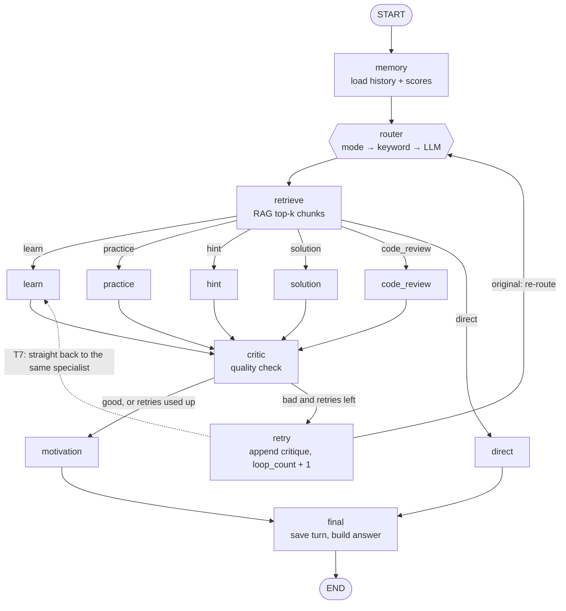

# DSA Coach — LangGraph multi-agent tutor, with a token-optimization demo

A DSA (data structures & algorithms) coaching agent built on **LangGraph**. Each student message is routed to a specialist agent (learn, practice, hint, solution, code review), a **critic** can send weak answers back for another try, and the app remembers conversation and score history.

This README covers four things:

1. [How the agent flow works](#2-agent-flow) — every node, every path.
2. [Where the LLM tokens go](#3-where-the-tokens-go-audit-of-the-original-flow) — an audit of the original flow.
3. [Nine token-optimization techniques](#4-token-optimization-techniques-t1t9) — implemented, each one switchable.
4. [A demo you can run locally](#5-demo-see-it-on-your-machine) — the same session before vs after, with per-node numbers.

**In a hurry?** No model needed for a first look (run from the project folder):

```bash
pip install langgraph langchain-core ollama python-dotenv streamlit
python -m demo.token_demo --mock
```

---

## Contents

1. [Quick start](#1-quick-start)
2. [Agent flow](#2-agent-flow)
3. [Where the tokens go (audit of the original flow)](#3-where-the-tokens-go-audit-of-the-original-flow)
4. [Token-optimization techniques (T1–T9)](#4-token-optimization-techniques-t1t9)
5. [Demo: see it on your machine](#5-demo-see-it-on-your-machine)
6. [Configuration reference](#6-configuration-reference)
7. [Fixes made along the way & known issues](#7-fixes-made-along-the-way--known-issues)
8. [Further techniques (not implemented)](#8-further-techniques-not-implemented)
9. [Project structure](#9-project-structure)
10. [Status: what has been tested](#10-status-what-has-been-tested)
11. [Troubleshooting](#11-troubleshooting)

### Source projects merged

| Source | Key contribution |
|---|---|
| **Root CodeCurry** | Scorecard (Correctness/Efficiency/Readability/Approach), progress persistence, score history |
| **AURA++** | LLM-based intent router, session memory, problem bank with topic/difficulty filtering |
| **lumina** | Multi-agent specialization (learn/practice/hint/solution/code_review), critic → retry loop, Gemini backend |
| **AgentOps** | Evaluation node, LangGraph checkpointer, annotated conversation history, thread_id |

---

## 1. Quick start

```bash
cd dsa_coach_standard

python -m venv .venv
source .venv/bin/activate            # Windows: .venv\Scripts\activate

# Minimum for the agent, UI and demo
pip install langgraph langchain-core ollama python-dotenv streamlit
# (requirements.txt also lists optional RAG back-ends; sentence-transformers pulls in torch)

cp .env.example .env                 # Windows: copy .env.example .env

# Local model (skip if you use Gemini or --mock)
ollama pull llama3.2

streamlit run ui/app.py              # chat UI with a live token meter
python -m demo.token_demo            # before/after token report
```

Use the agent from Python:

```python
from agents.graph import run

result = run("Explain BFS vs DFS", mode="learn", session_id="me")
print(result["final_response"])
```

Python 3.10+ is required (the code uses `X | None` annotations).

---

## 2. Agent flow

### 2.1 The graph



The dotted edge is what the `retry_direct` flag (T7) switches on: the intent is already known, so the retry jumps back to the same specialist (learn is shown as the example) instead of re-classifying.

### 2.2 Nodes

| Node | File | Calls the LLM? | Reads | Writes |
|---|---|---|---|---|
| `memory` | `agents/nodes.py` | no | `session_id` | `conversation_history` (last 10 messages), `score_history`, `avg_score`, retry counters |
| `router` | `agents/router.py` | only when rules don't decide (see 2.3) | `mode`, `question` | `intent`, `agent_type`, `route` |
| `retrieve` | `agents/nodes.py` → `rag/retriever.py` | no (vector/keyword lookup) | `question`, `intent` | `retrieved_knowledge`, `context` |
| `learn` | `agents/nodes.py` | **yes** — prose | `question`, `context`, `conversation_history` | `draft_response` |
| `practice` | `agents/nodes.py` → `problems/bank.py` | no | `question`, `topic`, `difficulty`, seen problem ids | `problem_id`, `problem`, `draft_response` |
| `hint` | `agents/nodes.py` | **yes** — prose | `problem`, `student_code`, `question`, `context` | `draft_response` |
| `solution` | `agents/nodes.py` | **yes** — prose | `problem`, `language`, `context` | `draft_response` |
| `code_review` | `agents/nodes.py` | **yes** — JSON | `student_code`, `problem`, `language`, `context` | `scorecard`, `score`, `score_history`, `avg_score`, narrative fields, `draft_response`; writes `progress.json` |
| `direct` | `agents/nodes.py` | no | – | `draft_response` (canned greeting) |
| `critic` | `agents/nodes.py` | **yes** — JSON verdict (a free length check runs first) | `draft_response`, `question` | `needs_retry`, `evaluation`, `critique` |
| `retry` | `agents/graph.py` | no | `critique` | `question` (critique appended), `loop_count + 1`, clears `draft_response` |
| `motivation` | `agents/nodes.py` | no | `avg_score` | `encouragement` (not part of the final text) |
| `final` | `agents/nodes.py` | no | `draft_response` | `final_response`, `answer`, `done`; **saves the turn** to `data/conversations/<session>.json` |

`hint`, `solution` and `code_review` use the current `problem`. It normally comes from an earlier `practice` turn in the same session, because the in-process checkpointer keeps state per `thread_id` (= `session_id`).

### 2.3 Routing rules (`agents/router.py`)

The router picks an `intent` in this order and stops at the first step that decides:

1. **Sidebar `mode`** (`learn`, `practice`, `hint`, `solution`, `code_review`, plus a few aliases) — free.
2. **Keyword rules** — whole-word matches such as *explain*, *hint*, *stuck*, *review*, *give me a problem* — free.
3. **LLM classification** — costs tokens. With T1 on it is reached only when no keyword matched. The original also sent a message here when only a *learn* keyword matched.

Intents: `learn`, `practice`, `hint`, `solution`, `code_review`, `direct`.

### 2.4 The critic loop

After every specialist (except `direct`) the `critic` reviews `draft_response`:

- Draft under 40 characters → **retry without calling the LLM** (free check).
- Otherwise it asks the LLM for `{"verdict": "good" | "bad", "critique": "..."}`.
- `bad` and `loop_count < max_retries` (default **2**) → `retry` appends the critique to the question and the specialist runs again.
- Once retries are used up the last draft is accepted.

### 2.5 What one turn costs (LLM calls)

Counted by running the real graph with call-recording on (baseline = original behaviour):

| Turn | Baseline calls | Optimized calls |
|---|---|---|
| "Explain BFS vs DFS…" (learn keyword) | 3 — router, learn, critic | **2** — learn, critic |
| "How can I get better at recursion?" (no keyword) | 3 — router, learn, critic | 3 — with a tiny router prompt |
| "Give me an easy array problem" | 1 — critic reviews a canned problem | **0** |
| "I'm stuck, can I get a hint?" | 2 — hint, critic | **1** |
| Review my code (`mode=code_review`) | 2 — review, critic | **1** |
| "Show me the full solution" | 2 | 2 |
| "hello!" | 0 | 0 |
| Same question again (fresh session) | same as the first time | **0** — cache |
| Critic rejects once (learn) | 6 — router, learn, critic, router, learn, critic | **4** — learn, critic, learn, critic |

### 2.6 State and persistence

| What | Where | Lifetime |
|---|---|---|
| Graph state (`AgentState`, `agents/state.py`) | in-process `MemorySaver`, keyed by `thread_id = session_id` | until the process restarts |
| Conversation history | `data/conversations/<session>.json` | durable |
| Scores / solved problems | `data/progress.json` | durable |
| Problem bank | `data/problems.json` (seeded on first run) | durable |

---

## 3. Where the tokens go (audit of the original flow)

Reading the original code, these are the places tokens are spent without much return. Each maps to a technique in section 4.

| # | Finding | Evidence | Fix |
|---|---|---|---|
| 1 | **The router asks the LLM to confirm a "learn" keyword hit.** `_keyword_intent()` returned `"learn"` both for a real match and as the default, so both went to the LLM. | "Explain BFS vs DFS" → 3 calls instead of 2 | T1 |
| 2 | **The router prompt is long for a one-word answer** (~140 tokens in, up to 1,200 allowed out). | 566 characters in, 1 word needed | T1 |
| 3 | **The critic reviews everything** — a problem picked from a list, a structured JSON review, a three-line hint. | `practice` → 1 critic call with 0 generation calls | T6 |
| 4 | **The critic gets 1,500 characters** of draft. | `draft[:1500]` | T6 |
| 5 | **RAG always returns 5 chunks** with noisy scoring (substring hits, so words like "a" or "of" match everything): ≈160 tokens added to every prompt, relevant or not. | 634–670 chars for every query, even "hello" | T3 |
| 6 | **RAG runs for intents that never read it** (`practice`, `direct`). Free with the in-memory KB, but a real embedding/DB call with Chroma or pgvector. | `retrieve` ran before `router` | T2 |
| 7 | **History is unbounded per message.** The last 6 messages go into the `learn` prompt at full length; one earlier answer can be several hundred tokens. | one long turn dominates the next prompts | T4 |
| 8 | **No output caps.** Prose calls allow 1,200 new tokens and nothing asks for brevity. | `num_predict = 1200` | T5 |
| 9 | **Retry re-classifies** the message (possibly another LLM call) and the question keeps growing. | `retry → router` | T7 |
| 10 | **Identical questions are recomputed.** Two students asking "Explain BFS vs DFS" pay twice. | no cache | T8 |
| 11 | **No visibility.** Nothing recorded tokens per call or per node. | – | `llm/usage.py` |

---

## 4. Token-optimization techniques (T1–T9)

Every technique is a flag in `llm/optim.py`. `OPT_PROFILE=baseline` turns all of them off (original behaviour), `optimized` (default) turns them all on, and `OPT_DISABLE=response_cache,selective_critic` switches individual ones off.

| # | Flag | Technique | Saves | Where |
|---|---|---|---|---|
| T1 | `lean_router` | Trust keyword hits; tiny fallback prompt; 8-token answer | LLM calls + input tokens | `agents/router.py` |
| T2 | `lazy_retrieval` | Skip RAG when the intent never reads it | retrieval work (not LLM tokens) | `agents/nodes.py` |
| T3 | `context_budget` | Fewer, more relevant chunks; char budget; cap huge code | input tokens | `rag/retriever.py`, `agents/nodes.py`, `llm/optim.py` |
| T4 | `history_window` | Last 4 turns, each clipped to 240 chars | input tokens | `llm/optim.py` (`window`) |
| T5 | `output_caps` | Per-node `max_tokens` + "under N words" instruction | output tokens | `llm/optim.py` (`CAPS`, `brief`) |
| T6 | `selective_critic` | Critic only for `learn`/`solution`; shorter draft | LLM calls + tokens | `agents/nodes.py` |
| T7 | `retry_direct` | Retry goes straight back to the same agent; critique capped at 200 chars | calls on retry paths | `agents/graph.py` |
| T8 | `response_cache` | Exact-match cache of prompt → answer | whole calls | `llm/client.py` |
| T9 | `model_tiering` | Router + critic use a smaller model when one is configured | cost per token | `llm/client.py` |

### T1 — Lean router

- **Before:** a *learn* keyword hit still triggered an LLM call with a ~140-token prompt and a 1,200-token allowance.
- **After:** any keyword hit is trusted (free). The LLM runs only when nothing matched, with a ~30-token prompt (`Classify into one word: …`), `temperature=0` and `max_tokens=8`.
- **Trade-off:** rules decide more often. Keywords use whole-word matching (so "hi" no longer fires on "which"), but review the keyword list for your users.

### T2 — Lazy retrieval

- The graph now routes first and retrieves second (`router → retrieve → agent`), so `retrieve` knows the intent and skips `practice` and `direct`.
- In every profile, retrieval is not repeated on a critic retry (the retry question has the critique appended, which would pollute the query).
- **Honest impact:** zero LLM tokens with the in-memory knowledge base. It matters when retrieval is an embedding call or a database round-trip.

### T3 — Context budget

- Top-k drops 5 → 3. In-memory scoring becomes content-word overlap weighted by rarity, with a relevance cut-off, so **fewer than k chunks come back when little is relevant**. Duplicates are dropped and a 700-character budget applies (`optim.fit_chunks`).
- Student code above 4,000 characters keeps its head and tail (`optim.cap_code`).
- Measured on the built-in knowledge base: "Explain BFS vs DFS" 634 → 248 chars (just the BFS and DFS chunks); "hello" 670 → 0.
- **Trade-off:** a marginal chunk may be dropped. Tune `RAG_MAX_CHARS` and the `0.4` cut-off in `rag/retriever.py`. With Chroma/pgvector use a similarity threshold instead.

### T4 — History window

- Only the `learn` prompt includes history. Baseline: last 6 messages, full length. Optimized: last 4, each whitespace-collapsed and clipped to 240 chars.
- In the demo, turn 8's `learn` prompt drops from 734 to 369 tokens (T3 and T4 together).
- **Trade-off:** the model forgets detail from older turns. The next step up is a rolling summary (section 8).

### T5 — Output caps

- Caps per node (`llm/optim.py → CAPS`): router 8, critic 80, learn 500, hint 220, solution 700 tokens, plus a one-line "Keep the whole answer under N words." in the prompt.
- **Trade-off:** a hard cap can cut a sentence off. The word limit in the prompt is what makes the model finish inside the cap, so keep the two consistent. This is the one technique whose payoff shows up only with a real model (see 5.3).
- Gemini: the cap is not sent to the API (2.5 models spend "thinking" tokens from the same budget, which can produce empty answers); only the prompt instruction applies there.

### T6 — Selective critic

- LLM critic only for `learn` and `solution` (free-form prose). Not for `practice` (a list lookup), `code_review` (structured JSON with a scorecard), `hint` (short) or `direct`. The free "draft too short → retry" check still runs for everything.
- The critic sees 800 characters instead of 1,500 and answers in at most 80 tokens.
- **Trade-off:** fewer safety nets. Cheap deterministic checks (contains a code block, mentions complexity) can stand in for the LLM on other intents.

### T7 — Direct retry

- The retry re-enters the same agent (context is still in state) instead of the router. This saves the router's LLM call when the message had no keyword, and stops the intent from flipping on a retry.
- **Honest impact:** small once T1 is on, because the router is mostly free by then.

### T8 — Response cache

- `chat()` hashes `(backend, model, json_mode, max_tokens, temperature, prompt)`. A hit returns the stored answer, records `cached=True`, and costs 0 tokens.
- It is exact-match on the **whole prompt**, so it hits when the prompt is identical, e.g. a new session asking a common first question. Once conversation history is in the prompt, hits get rarer; a semantic cache keyed on the question (section 8) raises the hit rate.
- **Trade-offs:** the answer is frozen (no variety); the cache lives in process memory, has no expiry and is shared by every session in the process. That is fine for a local demo, but key it per user/version before production.

### T9 — Model tiering

- Router and critic call `tier="small"`, which resolves to `OLLAMA_SMALL_MODEL` / `GEMINI_SMALL_MODEL`. Until you set one it is the same as the main model, so nothing changes.
- Token counts don't depend on the model; this saves **cost and latency per token** (e.g. `llama3.2:1b` for classification and verdicts, a bigger model for teaching). The demo reports how many tokens ran on the small tier.
- `OLLAMA_PLANNER_MODEL` (`qwen2.5-coder:7b`) is *larger* than the default `llama3.2` (3B), so it is not a cheap tier. That is why a separate small-model setting exists.

---

## 5. Demo: see it on your machine

### 5.1 What the demo does

`demo/token_demo.py` replays **one scripted tutoring session twice** through the real graph, first with all flags off (**baseline**), then with all on (**optimized**), and prints:

1. calls and tokens for each turn,
2. totals (calls, prompt tokens, completion tokens, cache hits, wall time),
3. tokens by node (where the budget goes),
4. a **quality guard-rail**: answer length per turn, flagged when the optimized answer is under half the baseline's,
5. optionally, a technique-by-technique waterfall (`--ablation`).

The session (9 turns; a 10th runs only with `--mock`):

| # | Turn | Path exercised |
|---|---|---|
| 1 | "Explain BFS vs DFS with an example" | learn via keyword (baseline double-checks with the LLM) |
| 2 | "How can I get better at recursion?" | learn via LLM router (no keyword) |
| 3 | "Give me an easy array problem to practice" | practice (no generation; baseline still runs the critic) |
| 4 | "I'm stuck, can I get a hint?" | hint using the problem from turn 3 |
| 5 | Review my code (`mode=code_review`) | JSON review + scorecard |
| 6 | "Show me the full solution" | solution |
| 7 | "hello!" | direct |
| 8 | "What is the time complexity of Dijkstra's algorithm?" | learn with a long history |
| 9 | Same as #1, **new student** | response cache |
| 10 | "Explain dynamic programming (retry-demo)" — *mock only* | critic rejects once → retry path |

Progress and conversations go to a temp folder. **Your `data/` directory is not touched.**

### 5.2 Run it

```bash
# 1. No model needed: validates the flow and prompt sizes in a couple of seconds
python -m demo.token_demo --mock

# 2. Against your real model (Ollama by default, or LLM_BACKEND=gemini in .env)
ollama serve                         # if it is not already running
ollama pull llama3.2
python -m demo.token_demo

# 3. Extras
python -m demo.token_demo --quick            # 4 turns instead of 9
python -m demo.token_demo --ablation         # + one pass per technique (many more model calls)
python -m demo.token_demo --show-answers     # read baseline vs optimized answers side by side
python -m demo.token_demo --trace            # print the [ROUTER] / [CRITIC] / [RETRIEVE] log lines
python -m demo.token_demo --estimate         # count prompt tokens as chars/4 on every backend
python -m demo.token_demo --json out.json    # keep the numbers
```

A full real-model run makes about 19 calls in the baseline pass and about 11 in the optimized pass (critic retries can add more). `--ablation` adds nine more passes, so plan for it to take several times longer.

### 5.3 Example output (`--mock`)

Captured from `python -m demo.token_demo --mock --ablation`. **Call counts and prompt sizes are real** (built by the actual nodes, estimated at ~4 chars/token). **Completions are canned** and identical in both passes.

```
1) PER TURN — LLM calls and total tokens (prompt + completion)

  #  Turn                        Intent      │     BASELINE     │    OPTIMIZED     │         Saved
                                             │ calls     tokens │ calls     tokens │ tokens      %
 ──────────────────────────────────────────────────────────────────────────────────────────────────
  1  Explain BFS vs DFS          learn       │     3      1,051 │     2        766 │    285  27.1%
  2  How to improve at recursion learn       │     3      1,315 │     3        878 │    437  33.2%
  3  Give me an array problem    practice    │     1        202 │     0          0 │    202 100.0%
  4  I'm stuck - hint            hint        │     2        600 │     1        260 │    340  56.7%
  5  Review my code              code_review │     2      1,044 │     1        579 │    465  44.5%
  6  Show full solution          solution    │     2        709 │     2        588 │    121  17.1%
  7  Greeting                    direct      │     0          0 │     0          0 │      0    -
  8  Dijkstra complexity         learn       │     3      1,513 │     2        947 │    566  37.4%
  9  Same as #1, new student     learn       │     3      1,051 │     0          0 │  1,051 100.0%  ⚡cache
 10  Critic rejects once (mock)  learn       │     6      2,199 │     4      1,550 │    649  29.5%

2) TOTALS

                                 BASELINE   OPTIMIZED       Saved       %
 ────────────────────────────────────────────────────────────────────────
 LLM calls                             25          15          10   40.0%
 Prompt tokens (input)              7,606       3,781       3,825   50.3%
 Completion tokens (output)         2,078       1,787         291   14.0%
 TOTAL TOKENS                       9,684       5,568       4,116   42.5%

3) WHERE THE TOKENS GO — per node (calls / tokens)

 Node                        BASELINE             OPTIMIZED
 ──────────────────────────────────────────────────────────
 learn                    6 /   3,964           5 /   2,473
 critic                  10 /   3,271           6 /   1,906
 router                   6 /     882           1 /      31
 code_review              1 /     717           1 /     579
 solution                 1 /     440           1 /     319
 hint                     1 /     410           1 /     260

5) TECHNIQUE-BY-TECHNIQUE (cumulative: each row adds one technique to the rows above)

 Enabled up to              calls    tokens  this step  vs base
 ────────────────────────────────────────────────────────────────────────────────────────
 + T1  Lean router             20     8,833       +851     8.8%
 + T2  Lazy retrieval          20     8,833         +0     8.8%
 + T3  Context budget          20     7,800     +1,033    19.5%
 + T4  History window          20     7,292       +508    24.7%
 + T5  Output caps             20     7,380        -88    23.8%
 + T6  Selective critic        17     6,334     +1,046    34.6%
 + T7  Direct retry            17     6,334         +0    34.6%
 + T8  Response cache          15     5,568       +766    42.5%
 + T9  Model tiering           15     5,568         +0    42.5%
```

**How to read it**

- **Biggest levers here:** the selective critic (T6), the context budget (T3), the cache (T8), the history window (T4) and the lean router (T1). Order matters in a cumulative table: a technique gets less credit if an earlier one already removed the waste.
- **Rows with 0 or a negative number are expected in `--mock`.** T2 saves retrieval work, not tokens. T5 adds an "under N words" line to each prompt, and the mock's fixed completions cannot get shorter, so it shows a small cost. Its payoff is real completions getting shorter, which only a real model shows. T7 only matters when the critic rejects *and* the router would call the LLM. T9 needs `OLLAMA_SMALL_MODEL` set to something smaller.
- Don't compare the mock's percentages with your real run. Use the mock to confirm the flow and the real run for numbers.

### 5.4 With a real model: what to expect and check

- **Stable signal:** call counts and prompt tokens fall much as in the mock run.
- **Noisy signal:** completion tokens depend on your model, and the critic may or may not reject a draft, so small differences between runs are noise. Run twice if a number looks odd.
- **Check the guard-rail (table 4).** If an optimized answer is much shorter, run with `--show-answers` and read both. If quality dropped, raise the matching cap in `llm/optim.py → CAPS`.
- **Token counts come from Ollama** (`prompt_eval_count`, `eval_count`) or Gemini (`usage_metadata`). Ollama can reuse its KV cache for a repeated prompt prefix, which may make the reported prompt count lower than the prompt's real size. If the comparison looks suspicious, use `--estimate` to count prompt tokens as chars/4 on both passes.
- **Context window:** Ollama's default `num_ctx` is only a few thousand tokens (it depends on version and hardware) and it truncates silently. Shorter prompts reduce that risk too.

### 5.5 Live in the UI

```bash
streamlit run ui/app.py
```

- The sidebar has a **⚡ Token optimizations** toggle and a running token counter.
- After each answer a caption shows e.g. `🔢 2 LLM call(s) · 766 tokens (504 in / 262 out)`, plus ⚡ cache hits when they happen.
- Try this sequence:
  1. Toggle **on**, ask "Explain BFS vs DFS with an example" and note the tokens.
  2. Click **Clear Conversation**, ask the same thing again → ⚡ cache hit, ~0 tokens. (Clearing matters: the cache matches the whole prompt, and history is part of it.)
  3. Toggle **off**, click **Clear Conversation**, ask again → the baseline cost.
- Flags are process-wide, which is fine for a local demo but not for a multi-user server.

### 5.6 In code

```python
from agents.graph import run
from llm import optim
from llm.usage import tracker

optim.set_profile("baseline")            # or "optimized"
mark = tracker.mark()
run("Explain BFS vs DFS", session_id="try-1")
print(tracker.totals_for(tracker.records[mark:]))
# {'calls': 3, 'cache_hits': 0, 'prompt_tokens': ..., 'completion_tokens': ..., 'total_tokens': ..., ...}
print(tracker.by_tag_for(tracker.records[mark:]))     # per node
```

Enable/disable a single technique with `optim.F.response_cache = False`, or in `.env`: `OPT_DISABLE=response_cache`.

### 5.7 See the graph in LangGraph Studio (optional)

Studio shows the nodes lighting up as a turn moves through the graph. It does not show tokens; use the demo or the UI for those.

```bash
pip install "langgraph-cli[inmem]"
langgraph dev                        # reads langgraph.json → graph "dsa_coach"
# open the Studio URL it prints
```

`langgraph.json` points at `agents/graph.py:graph`, a checkpointer-free build. **Don't** point it at `dsa_coach_graph`: the dev server refuses graphs that carry their own checkpointer, because the platform provides persistence.

---

## 6. Configuration reference

| Variable | Default | Description |
|---|---|---|
| `LLM_BACKEND` | `ollama` | `ollama`, `gemini`, or `mock` (offline) |
| `OLLAMA_MODEL` | `llama3.2` | Main chat model |
| `OLLAMA_SMALL_MODEL` | *(= `OLLAMA_MODEL`)* | Cheaper tier for router + critic (T9) |
| `OLLAMA_PLANNER_MODEL` | `qwen2.5-coder:7b` | Legacy `planner=True` switch, not used by the nodes |
| `GEMINI_API_KEY` / `GEMINI_MODEL` / `GEMINI_SMALL_MODEL` | – / `gemini-2.5-flash` / *(= main)* | Gemini settings |
| `RAG_BACKEND` | `memory` | `memory`, `pgvector`, or `chroma` |
| `DATABASE_URL` | – | PostgreSQL URL for pgvector |
| `OPT_PROFILE` | `optimized` | `optimized` = T1–T9 on, `baseline` = all off |
| `OPT_DISABLE` | *(empty)* | Comma-separated flags to switch off, e.g. `response_cache,selective_critic` |
| `TOKEN_COUNT_MODE` | `api` | `api` = backend counters, `estimate` = prompt tokens as chars/4 |

`.env` is now loaded automatically (`python-dotenv`); real environment variables win over `.env`.

Tunable budgets live at the top of `llm/optim.py`: `CAPS`, `RAG_MAX_CHARS`, `HISTORY_TURNS_OPT`, `HISTORY_CHARS_OPT`, `CODE_MAX_CHARS`, `CRITIC_DRAFT_CHARS_OPT`, `CRITIQUE_MAX_CHARS`.

---

## 7. Fixes made along the way & known issues

### Fixed (applies to baseline and optimized alike)

These were needed to run and to measure the flow honestly:

| # | Problem in the original | Fix |
|---|---|---|
| 1 | `run()` raised `ValueError: Checkpointer requires … thread_id`: the graph is compiled with `MemorySaver` but was invoked without a thread. | `invoke(..., config={"configurable": {"thread_id": session_id}})` |
| 2 | **Conversation was never saved** (`save_message` was never called), so `memory_node` always loaded an empty history and "seen problem" tracking never worked. | `final_node` saves the user message and the answer (with `problem_id` for practice turns) |
| 3 | `.env` was never loaded, so `cp .env.example .env` had no effect. | `load_dotenv()` in `llm/client.py` |
| 4 | Code review's JSON call inherited a **120-token limit** meant for one-word planner replies, so the 8-field review was likely cut off and fell back to a canned message. | `max_tokens=500` for code review |
| 5 | Keyword rules matched substrings (`"hi"` inside "which", "high"). | Whole-word matching, simple plurals |
| 6 | A checkpointed thread leaked last turn's `scorecard`, `draft_response`, `critique`. | Reset per turn in `run()` |
| 7 | The router's LLM answer was parsed by iterating a `set` (non-deterministic when two intents appear). | First occurrence wins |
| 8 | `langgraph dev` rejects a graph with its own checkpointer. | Added a checkpointer-free `graph` export + `langgraph.json` |

With every flag off (`OPT_PROFILE=baseline`) the prompts sent to the model are byte-identical to the original's, and the sequence of LLM calls is the same, for the inputs that were compared (see section 10).

### Known issues (not changed)

- **Hint level never escalates.** `hint_node` sets the level from `loop_count` (the *critic-retry* counter, reset to 0 every turn) rather than from how many hints the student has asked for, so it is almost always level 1.
- **A critic retry of `code_review` runs the review again** and appends a second score to `score_history` and `progress.json` (baseline only; with T6 the critic skips code review).
- **pgvector retrieval is a placeholder**: `_retrieve_pgvector` compares the raw query text with `embedding <->`, which needs an embedding vector, and `embed_prompt` is unused.
- **`motivation` output isn't shown**: `final_node` returns only `draft_response`.
- The Streamlit UI logs a deprecation warning for `use_container_width` on newer Streamlit versions (cosmetic).

---

## 8. Further techniques (not implemented)

| Technique | Idea | When it pays off |
|---|---|---|
| **Prompt-prefix ordering** | Put static instructions first and per-turn data last, so provider prompt caching (or Ollama's KV-cache reuse) can reuse the prefix | Long, stable instructions; cloud APIs with prompt caching |
| **Semantic cache** | Cache by question embedding + intent instead of the whole prompt | Many students asking similar things; raises the hit rate of T8 |
| **Rolling summary memory** | Summarise turns older than the window into 2–3 sentences | Long sessions; lets T4 shrink further without amnesia |
| **Single-call generate + self-check** | Ask the specialist to append a `CONFIDENCE: high/low` line and retry only on low, instead of a separate critic call | Removes the critic call for most turns |
| **Stored hints and solutions** | Keep hints and reference solutions with each problem in the bank | The bank is small and curated: zero generation for hints |
| **Real embeddings + similarity threshold** | Replace keyword scoring with an embedding model and a distance cut-off | Larger knowledge bases (Chroma/pgvector) |
| **Structured-output slimming** | Ask code review for fewer/shorter fields, or split "score" and "feedback" | Code-review-heavy usage |
| **Parallel nodes** | Run independent LLM calls concurrently | Latency rather than tokens |

---

## 9. Project structure

```
dsa_coach_standard/
├── agents/
│   ├── state.py            # AgentState TypedDict
│   ├── router.py           # mode → keyword → LLM router (T1)
│   ├── nodes.py            # memory, retrieve, learn, practice, hint, solution,
│   │                       # code_review, critic, motivation, direct, final
│   └── graph.py            # graph definition, run(), `graph` / `dsa_coach_graph`
├── llm/
│   ├── client.py           # Ollama / Gemini / mock client, cache (T8), tiers (T9)
│   ├── optim.py            # ★ T1–T9 flags, budgets, prompt helpers
│   ├── usage.py            # ★ per-call token & latency tracker
│   └── mock_backend.py     # ★ offline stand-in for the demo
├── rag/retriever.py        # pgvector / Chroma / in-memory (+ scored retrieval, T3)
├── memory/store.py         # progress + conversation persistence
├── problems/bank.py        # problem bank (seeded)
├── ui/app.py               # Streamlit UI (+ token meter and optimization toggle)
├── demo/token_demo.py      # ★ before/after demo
├── langgraph.json          # ★ for `langgraph dev` / Studio
├── .env.example, .gitignore, requirements.txt
└── data/                   # auto-created: progress.json, problems.json, conversations/
```

★ = added. Modified: `agents/*`, `llm/client.py`, `rag/retriever.py`, `memory/store.py`, `ui/app.py`, `.env.example`, `requirements.txt`.

---

## 10. Status: what has been tested

- **Baseline equivalence:** with all flags off, the prompts for router, learn, hint, solution, code review and critic are byte-identical to the original's, retrieval output is identical, and the LLM-call sequence matches the original across 9 scripted turns (including the critic-retry path).
- **Mock demo:** `python -m demo.token_demo --mock --ablation` runs end to end (output in 5.3).
- **UI:** the Streamlit app was exercised headless (Streamlit's `AppTest`) with the mock backend: chat, token caption, cache hit and the toggle.
- **LangGraph dev server:** started with `langgraph dev`, the `dsa_coach` graph loaded and answered a run through the HTTP API (mock backend). A graph carrying its own checkpointer was rejected, as noted in 5.7.
- **Ollama client:** request/response handling was checked against the `ollama` library's real response types with the network call stubbed.

**Not yet done:** a measured run against a real Ollama or Gemini model. The numbers in 5.3 come from the mock backend. Run the demo on your machine and use your own figures.

---

## 11. Troubleshooting

| Symptom | Fix |
|---|---|
| `Cannot reach Ollama …` from the demo | `ollama serve`, then `ollama pull llama3.2`; or use `--mock` |
| `Model(s) not pulled: …` | `ollama pull <model>` for `OLLAMA_MODEL` (and `OLLAMA_SMALL_MODEL` if set) |
| Demo prints `backend errors, numbers are not meaningful` | The model call failed; re-run with `--trace` to see the error |
| Baseline token counts look too low | Ollama KV-cache reuse; run with `--estimate` |
| `ModuleNotFoundError: agents` / `demo` | Run from the `dsa_coach_standard` folder with `python -m demo.token_demo` |
| `.env` values ignored | Real environment variables override `.env`; unset them or restart the terminal |
| `langgraph dev`: "includes a custom checkpointer" | Point `langgraph.json` at `graph`, not `dsa_coach_graph` |
| Code review shows "AI evaluator could not produce structured output" | The model didn't return valid JSON; try a larger model or check `--trace` |
| Optimized answers are too short | Raise the relevant value in `llm/optim.py → CAPS`, or `OPT_DISABLE=output_caps` |

---

## Scorecard (code review)

| Criterion | Max | What it measures |
|---|---|---|
| Correctness | 4 | Does it solve the problem? |
| Efficiency | 3 | Is the time/space complexity optimal? |
| Readability | 2 | Clean code, good variable names |
| Approach | 1 | Sound algorithmic strategy |
| **Total** | **10** | |
